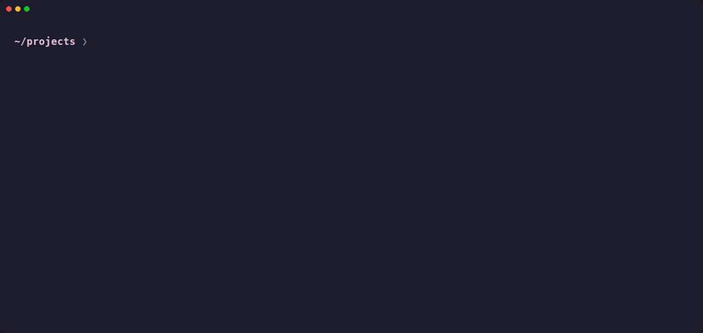

<div align="center">

# 🧹 kika

**Recupere gigabytes de disco sem medo de apagar o que não devia.**

O kika varre seus projetos atrás de `node_modules`, builds, `target/` do Rust e arquivos temporários,<br>
soma o que os caches do Docker, pnpm, uv, yarn, npm e Go estão ocupando e deixa você escolher o que limpar.


[](https://github.com/juniormartinxo/kika/actions/workflows/ci.yml)




</div>

---

## ✨ Destaques

- 🔍 **Relatório primeiro, sempre.** Rodar `kika` nunca apaga nada: ele mostra o que encontrou e quanto espaço dá para liberar
- 🧯 **Só lixo de projeto.** Pastas de programas, extensões de editor e backups fora de repositórios ficam de fora, mesmo rodando no `$HOME` inteiro
- 🗂️ **Lista interativa.** Os achados são agrupados por repositório git; marque os que quiser e limpe só eles, ou tudo de uma vez
- 🌍 **Caches globais inclusos.** Docker build cache, pnpm store, uv, yarn, npm e os caches do Go entram no mesmo relatório
- 🦀 **Rust do jeito certo.** `target/` só é tratado ao lado de um `Cargo.toml` e é limpo com `cargo clean --offline`
- 🟢 **Entende fnm e nvm.** Encontra `npm`, `pnpm` e `yarn` mesmo fora de um shell inicializado (cron, scripts), inclusive com nvm-windows
- 🪟 **Multiplataforma.** Linux, macOS, Windows e WSL, com CI rodando nos três sistemas
- ⚡ **Cara de CLI moderna.** Spinner com progresso no stderr, saída limpa em pipes e respeito ao `NO_COLOR`

## 📦 Instalação

Requer [Rust](https://rustup.rs) (edição 2024).

```bash
cargo install --git https://github.com/juniormartinxo/kika
```

Ou a partir de um clone local:

```bash
git clone https://github.com/juniormartinxo/kika
cd kika
cargo install --path .
```

## 🚀 Uso rápido

```bash
kika                 # relatório do diretório atual + caches globais (não apaga nada)
kika ~/projetos      # o mesmo, para outro diretório
kika clean           # remove tudo o que o relatório lista, após confirmação
kika clean --yes     # remove sem perguntar (ideal para automação)
```

| Comando                                                  | O que faz                                                      |
| -------------------------------------------------------- | -------------------------------------------------------------- |
| `kika [path]`                                            | Relatório completo; no terminal abre a lista interativa        |
| `kika report [path] --plain`                             | Relatório em texto, sem interação                              |
| `kika report [path] --output relatorio.txt`              | Salva o relatório em arquivo                                   |
| `kika clean [path]`                                      | Pede confirmação e remove tudo, incluindo os caches globais    |
| `kika clean [path] --yes`                                | Remove sem prompt                                              |
| `kika clean [path] --no-caches`                          | Limpa só o diretório, sem tocar nos caches globais             |
| `kika clean --docker-builder --pnpm-store`               | Limpa o diretório e apenas os caches escolhidos                |
| `kika report [path] --include-old-files --older-than-days 90` | Inclui arquivos com mais de 90 dias (com `clean`, são removidos) |

Rode `kika --help` para a lista completa de opções e `kika -v` para ver a versão instalada.

## 🖥️ Lista interativa

No terminal, `kika` abre uma lista com tudo o que foi encontrado:

```
┌ kika · 12 groups · 19.5 GB reclaimable ──────────────────────────────────┐
│      Name                      Items      Size Contents                  │
│› [x] storefront                    3    1.1 GB node_modules, .next       │
│  [ ] design-system                 3  467.0 MB node_modules, dist, temp… │
│  [x] sketches                      1   64.0 MB node_modules              │
│      Global caches                                                       │
│  [ ] uv cache                      1    7.1 GB uv-cache                  │
│  [ ] Docker build cache            1    2.9 GB docker-cache              │
└──────────────────────────────────────────────────────────────────────────┘
 Clean selected · 2 · 1.1 GB    Clean all · 19.5 GB
```

| Tecla                   | Ação                                       |
| ----------------------- | ------------------------------------------ |
| `↑` `↓` / `j` `k`       | Navegar                                    |
| `PgUp` `PgDn`           | Pular uma página                           |
| `Home` `End` / `g` `G`  | Ir ao início ou ao fim                     |
| `espaço` ou clique      | Marcar/desmarcar o grupo                   |
| `a`                     | Marcar/desmarcar tudo                      |
| `Tab`                   | Alternar o foco entre lista e botões       |
| `Enter`                 | Marcar ou acionar o botão focado           |
| `c`                     | Limpar os selecionados                     |
| `C`                     | Limpar tudo                                |
| `q` / `Esc` / `Ctrl+C`  | Sair sem apagar nada                       |

- Os itens são agrupados pelo repositório git mais próximo, sem subir acima do diretório escaneado; fora de um repositório, pelo diretório do projeto. Cada cache global vira uma linha própria
- Antes de limpar, uma confirmação mostra quantos grupos, itens e bytes serão removidos, e só `y` confirma
- Teclas digitadas durante o scan são descartadas, para não acionarem nada sem querer
- Com pipe, `--output` ou `--plain`, sai o relatório em texto, sem interação

## 🔎 O que o kika encontra

**No diretório escaneado**

| Alvo                                 | Quando conta                                                                  |
| ------------------------------------ | ----------------------------------------------------------------------------- |
| `node_modules`                       | Com `package.json` ao lado, num repositório git ou com lockfile (`package-lock.json`, `pnpm-lock.yaml`, `yarn.lock`, `bun.lock`) na pasta ou na raiz do workspace. Cópias renomeadas (`node_modules_old`, `node_modules.bak`) entram inteiras |
| `dist`, `.next`                      | Mesma regra do `node_modules`                                                 |
| `target`                             | Com `Cargo.toml` ao lado, limpo via `cargo clean --offline`                   |
| `.tmp`, `.temp`, `.bak`, `.old`, `.orig`, `.rej`, `.swp`, `.swo` | Só dentro de um repositório git                   |
| `.DS_Store`, `Thumbs.db`, `Zone.Identifier` | Em qualquer lugar                                                      |
| Arquivos antigos                     | Só com `--include-old-files` e `--older-than-days`                            |

**Caches globais** (fora do diretório escaneado, todos incluídos por padrão)

| Flag               | Cache                               | Comando executado no `clean`   |
| ------------------ | ----------------------------------- | ------------------------------ |
| `--docker-builder` | Build cache do Docker               | `docker builder prune --force` |
| `--pnpm-store`     | Pacotes não referenciados do pnpm e stores de versões antigas (`v3`, `v10`...) | `pnpm store prune`; as stores antigas são apagadas |
| `--uv-cache`       | Cache do uv                         | `uv cache clean`               |
| `--yarn-cache`     | Cache do yarn                       | `yarn cache clean`             |
| `--npm-cache`      | Cache do npm                        | `npm cache clean --force`      |
| `--go-cache`       | Build cache do Go (`GOCACHE`)       | `go clean -cache`              |
| `--go-modcache`    | Módulos baixados (`GOMODCACHE`)     | `go clean -modcache`           |

Sem flags de cache, todos entram. Com uma ou mais flags, só os escolhidos entram; `--no-caches` deixa os caches globais de fora.

<details>
<summary><b>Como os caches são medidos e encontrados</b></summary>

- O tamanho no relatório é o espaço que volta ao disco. Um arquivo com vários hardlinks só conta quando todos os links estão dentro do que será apagado: os `node_modules` do pnpm e os ambientes do uv são hardlinks para a store e o cache, e apagar uma das cópias não libera nada. No Windows, onde a contagem de links não está disponível, vale o tamanho dos arquivos
- Para o Docker, o tamanho vem do `Reclaimable` de `docker system df`. Com o Docker Desktop (WSL, Windows, macOS), esse espaço fica no disco virtual dele, não no disco escaneado: aparece à parte, em "Also reclaimable on other disks", fora do total
- No pnpm, o valor ainda é um teto: o `pnpm store prune` também mantém pacotes de projetos que ele tem registrados. As stores de versões antigas do pnpm (`v3`, `v10` ao lado da `v11` atual) não são usadas nem limpas pelo pnpm atual, então o kika as lista e apaga; arquivos ainda ligados a uma instalação antiga sobrevivem, e esses projetos continuam funcionando
- No `clean`, o espaço informado é o realmente liberado, medido de novo após a limpeza ou lido da saída do Docker
- Ferramenta ausente ou com erro gera um aviso e o cache é ignorado, sem interromper o restante
- `npm`, `pnpm` e `yarn` são procurados primeiro no `PATH`. Se não estiverem lá, o kika usa o Node do fnm (`$FNM_DIR`, `~/.local/share/fnm`, `~/.fnm`) ou do nvm (`$NVM_DIR`, `~/.nvm`), preferindo o alias `default` e depois a versão mais recente instalada. O `bin` dessa versão vai para o `PATH` do processo filho, para que o `node` seja encontrado
- No Windows, os shims `.cmd` de `npm`, `pnpm` e `yarn` são reconhecidos, e o Node também é procurado no fnm (`%APPDATA%\fnm`) e no nvm-windows (`%NVM_SYMLINK%`, `%NVM_HOME%`)
- O `go` é procurado no `PATH` e, se não estiver lá, em `$GOROOT/bin`, `/usr/local/go/bin` ou `%ProgramFiles%\Go\bin`
- Limpar o cache de módulos do Go só obriga o próximo build a baixar as dependências de novo. Ele é apagado com `go clean -modcache` porque o Go grava os módulos como somente leitura

</details>

## 🛡️ Segurança

O kika foi feito para rodar até no `$HOME` inteiro sem tocar no que não é lixo de desenvolvimento.

**Onde ele nunca entra**

- Pastas ocultas (`.vscode`, `.vscode-server`, `.cursor`, `.cache`, `.config`, `.local`, `.cargo`, `.git`...), onde ficam extensões de editor, binários de ferramentas e configurações
- `AppData`, `Library`, `Applications`, `Program Files`, `Program Files (x86)`, `ProgramData`, `Windows` e `$Recycle.Bin` (sem diferenciar maiúsculas), onde ficam programas instalados e arquivos do sistema
- Pastas com `app.asar` ou `node_modules.asar`, que são apps Electron instalados (VS Code, Cursor, Dusky...), onde quer que estejam
- `node_modules` sem `package.json` ao lado, como instalações globais do npm
- Links simbólicos
- O diretório escaneado em si nunca é filtrado pelo nome: `kika ~/.config/meu-projeto` funciona normalmente

**O que ele não considera lixo**

- `dist` e `node_modules` sem um `package.json` ao lado, nem os que estão dentro de outro `node_modules`
- `dist` e `node_modules` de um `package.json` sem repositório git e sem lockfile: é assim que programas instalados empacotam suas dependências. Um lockfile no próprio home não conta
- `.bak`, `.old` e afins fora de um repositório git, porque ali costumam ser o backup de alguém (IRPF, AutoCAD, SketchUp). Um `.git` no próprio home (repositório de dotfiles) não conta
- `target/` sem `Cargo.toml` ao lado

**Como ele apaga**

- O comando padrão é o relatório, que nunca apaga nada
- Remoção real só acontece com `kika clean` ou pela lista interativa, sempre com confirmação (a menos que você passe `--yes`)
- A remoção é definitiva, sem passar pela lixeira. Revise a lista antes de confirmar "Clean all"
- Limpeza de arquivos antigos exige `--include-old-files` e `--older-than-days`
- Sem `cargo` no `PATH`, o kika reporta o `target/`, mas a limpeza falha com aviso, sem remoção forçada
- O antigo `--apply` ainda é aceito no `clean`, mas é redundante

## 🎬 Regravando o GIF

O GIF acima é gerado com [VHS](https://github.com/charmbracelet/vhs) a partir de [`demo/demo.tape`](demo/demo.tape). O script [`demo/setup.sh`](demo/setup.sh) monta um workspace descartável em um diretório temporário, com arquivos esparsos e ferramentas de cache falsas no `PATH`, então gravar nunca toca nos seus caches de verdade:

```bash
vhs demo/demo.tape   # gera assets/demo.gif
```
